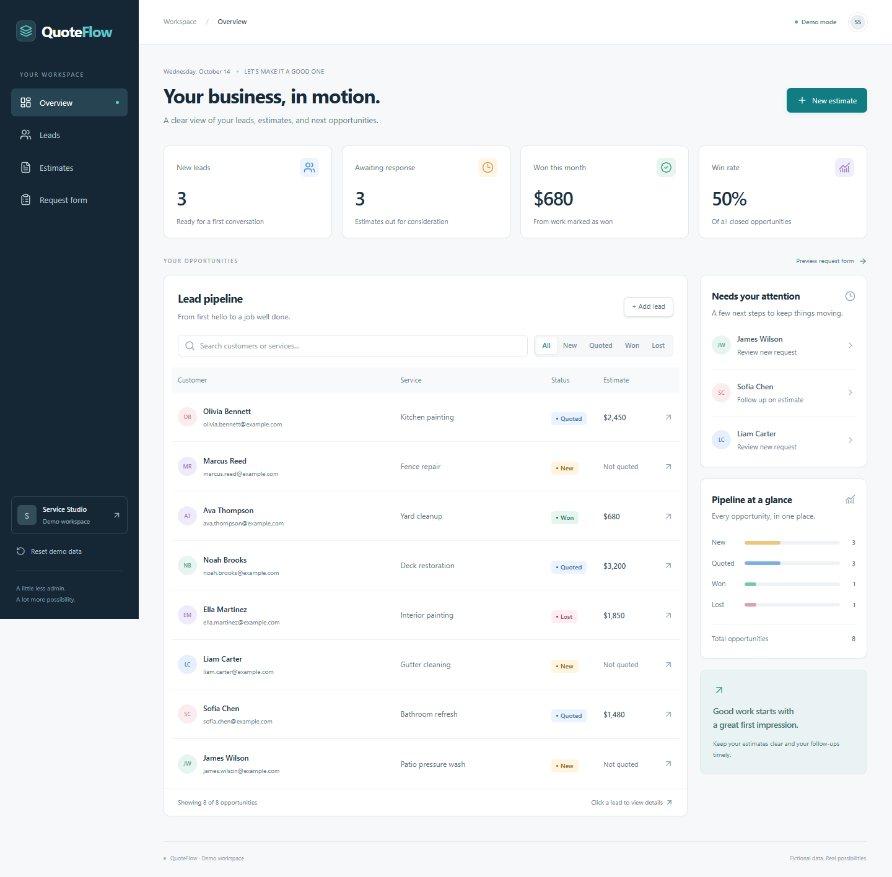

# QuoteFlow

A clean, responsive lead and estimate dashboard for small service businesses.



## Demo features

- Capture customer requests and manage leads.
- Search and filter New, Quoted, Won, and Lost opportunities.
- Create and edit estimates with itemized pricing.
- Track pipeline totals and outcomes.
- Work comfortably on desktop, tablet, and mobile.

This public edition uses fictional sample data and browser storage. It does not send emails, process payments, or connect to a live customer database. Use fictional information when trying it.

## Run locally

Requires Node.js 24 and pnpm 11.

```sh
pnpm install --frozen-lockfile
pnpm dev
```

Open http://127.0.0.1:5178.

## Development checks

```sh
pnpm test --run
pnpm typecheck
pnpm lint
pnpm build
pnpm test:e2e
```

Browser tests use Microsoft Edge by default. For Chromium, install it with `pnpm exec playwright install chromium` and set `PLAYWRIGHT_CHANNEL=chromium`.

## Built with

React, TypeScript, Vite, Tailwind CSS, and shadcn/ui.

## Documentation

- [Demo design](docs/specs/2026-10-14-quoteflow-design.md)
- [Demo implementation plan](docs/plans/2026-10-14-quoteflow-implementation.md)
- [Verified behavior](docs/verification.md)
- [Release checklist](docs/release-checklist.md)

## License

[MIT](LICENSE). Third-party components retain their respective licenses.
